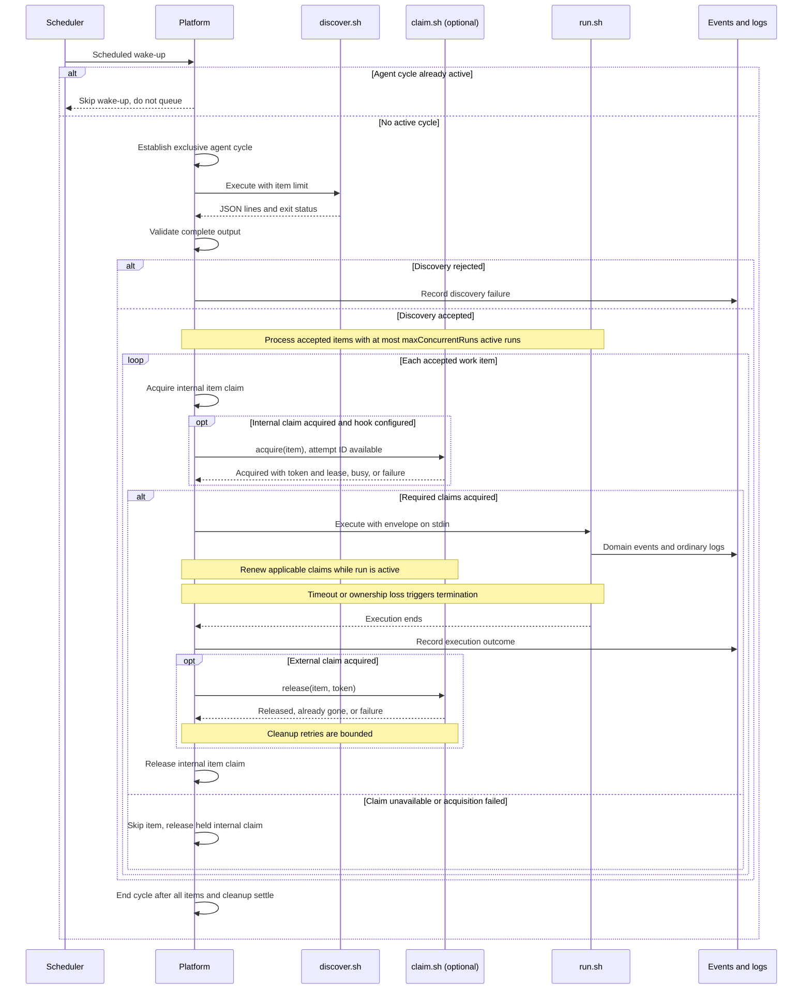

This diagram shows the accepted discovery path and per-item processing. Failure behavior is defined in the specification. Items can execute concurrently; the loop represents each item's lifecycle rather than requiring serial execution.

